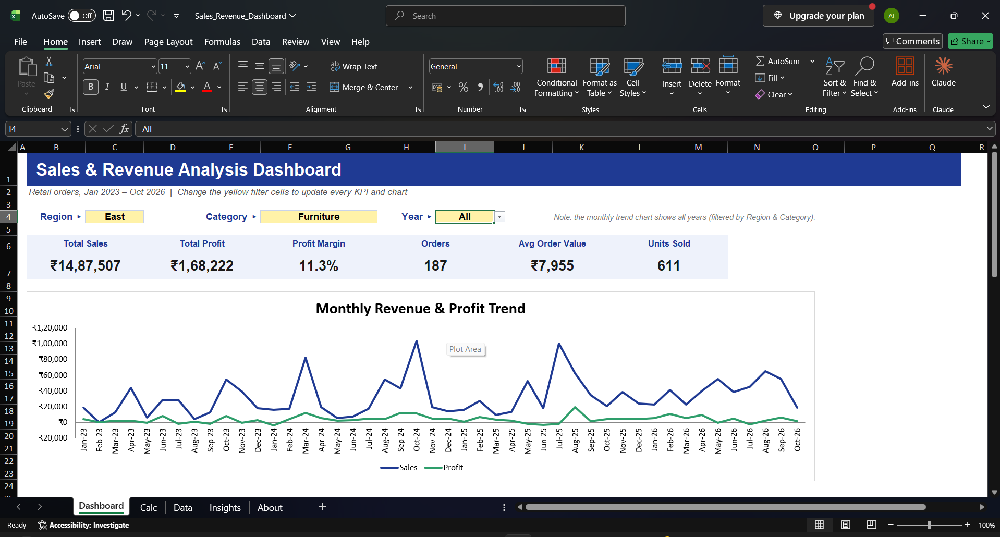
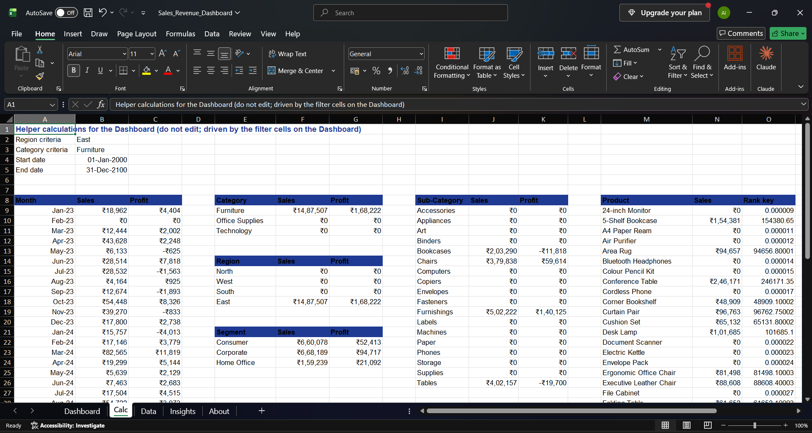

# Data Analytics Internship Projects – Thiranex EduTech

Projects completed during my remote **Data Analytics Internship at Thiranex EduTech LLP** (Nov–Dec 2026).
All three tasks use the same retail sales dataset, so together they tell one end-to-end story:
**describe the business → understand the customers → forecast the future.**

| # | Project | Tools | Status |
|---|---------|-------|--------|
| 1 | [Sales & Revenue Analysis Dashboard](Task1-Sales-Dashboard) | Excel | ✅ Done |
| 2 | [Customer Segmentation (RFM + K-Means)](Task2-Customer-Segmentation) | Python, pandas, scikit-learn, seaborn | ✅ Done |
| 3 | [Predictive Analytics – Sales Forecasting](Task3-Sales-Forecasting) | Python, scikit-learn, SciPy | ✅ Done |
## Dataset
`retail_sales_data.csv` has **5,947 order lines** from **662 customers**, covering Jan 2023 – Oct 2026 (16 columns: order, customer, segment, city/state/region, category, sub-category, product, quantity, unit price, discount, sales, profit).
It is a synthetic dataset modelled on the classic *Superstore* structure and adapted to Indian regions, with realistic growth, festive seasonality and discount effects.

---

## Task 1 – Sales & Revenue Analysis Dashboard

An interactive Excel dashboard for tracking KPIs and finding what drives revenue and profit.



**Features**
- Dropdown filters for **Region, Category and Year** that update every KPI and chart
- KPI cards: Total Sales, Total Profit, Profit Margin, Orders, Average Order Value, Units Sold
- Charts: monthly revenue & profit trend, sales/profit by category and region, top 10 products, profit by sub-category

**How it works**
- KPIs are built with `SUMIFS` / `COUNTIFS`; choosing "All" passes a `*` wildcard as the criteria
- The Year filter is converted into a start/end date range
- The Top 10 ranking is dynamic, using `LARGE` + `INDEX/MATCH` on a helper table

**Key insights**
- **₹3.61 Cr sales and ₹79.3 L profit** overall, a **22.0% margin**
- Sales grew **19.9% in 2024** and **8.0% in 2025**
- **Oct–Nov (festive season) contributes 24.6%** of yearly sales, versus 16.7% if sales were spread evenly
- **Technology** is the largest category (₹1.54 Cr); **Office Supplies** has the best margin (29.1%)
- **Tables is the only loss-making sub-category** (₹-1.92 L) because of heavy discounting
- Orders with **no discount earn a 30.3% margin**, while orders discounted **30% or more lose 26.7%**
- **West** leads on sales; **East** has the lowest margin (15.8%) due to higher discounts

**Recommendations:** stock up and plan campaigns ahead of Oct–Nov, review pricing on Tables and Bookcases, and cap discounts, especially in the East region.



---

## Task 2 – Customer Segmentation (RFM + K-Means)

Groups customers by buying behaviour so the business can target each group with the right action.
📓 **[Open the notebook](Task2-Customer-Segmentation/Customer_Segmentation.ipynb)**, which contains all code, charts and analysis.

**Approach**
1. Built one row per customer with **RFM** features: **R**ecency (days since last order), **F**requency (orders), **M**onetary (total spend)
2. Applied `log1p` to fix heavy right skew, then `StandardScaler` so each feature carries equal weight
3. Chose **k = 4** using the **elbow method** and **silhouette score** (0.368, the best value after k = 2, which is too coarse to act on)
4. Clustered with **K-Means** and automatically mapped clusters to business segment names
5. Profiled each segment by value, category preference, customer type, region and discount behaviour

**Segments found**

| Segment | Customers | Revenue share | Profile |
|---|---|---|---|
| 🟢 **Champions** | 25.7% | **65.0%** | Order often (median 17 orders), bought recently (~26 days ago), most Technology-heavy |
| 🟠 **At Risk** | 28.7% | 25.9% | High past value (₹93.5 L) and highest order value, but no order in a median of **330 days** |
| 🔵 **New / Promising** | 16.5% | 5.2% | Bought recently (~44 days ago) but only ~3 orders; prefer Furniture and Office Supplies |
| ⚪ **Lost / Hibernating** | 29.2% | 3.9% | Mostly one-time buyers, inactive for a median of **621 days** |

**Key insights**
- **A quarter of customers bring in two-thirds of revenue**, so retaining Champions is critical
- **At Risk customers are the biggest opportunity**: valuable buyers who are slipping away
- **Discount use is almost the same in every segment (9–10%)**, so loyalty comes from purchase behaviour, not discounts

**Recommendations:** a VIP or loyalty programme for Champions, personalised win-back campaigns for At Risk customers, second-purchase incentives for New customers, and only low-cost automated outreach for Lost customers.

**Output:** `customer_segments.csv` contains all 662 customers with their RFM values and assigned segment.

---

## How to run
```bash
pip install pandas numpy matplotlib seaborn scikit-learn
```
Clone the repo and open the notebooks from inside their task folders. They read `../retail_sales_data.csv`.

---
## Task 3 – Predictive Analytics: Sales Forecasting

Forecasts monthly sales for the next 12 months to support inventory and campaign planning.
📓 **[Open the notebook](Task3-Sales-Forecasting/Sales_Forecasting.ipynb)**

**Approach**
- Aggregated orders into a monthly time series and checked it for gaps and outliers
- Explored trend and seasonality: Oct–Nov run ~40% above an average month; Feb and May are the weakest
- Time-based train/test split (last 12 months held out) to compare three models:

| Model | MAPE |
|---|---|
| Seasonal Naive (baseline) | 21.8% |
| **Linear Regression** (trend + month dummies) | **13.4%** ✅ |
| Holt-Winters Exponential Smoothing | 13.9% |

**Forecast (Nov 2026 – Oct 2027):** **₹1.27 Cr (+7.6%)**, peaking in Oct–Nov. Technology is expected to grow fastest (+9.3%).

**Recommendations:** build inventory by September for the festive peak, run promotions in slow months (Feb, May), and retrain the model monthly.
## Author
**Aditya Chauhan** – B.Tech CSE, IIIT Kota
