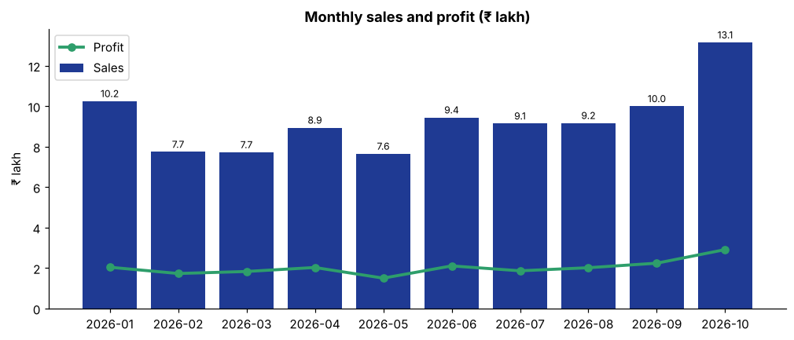
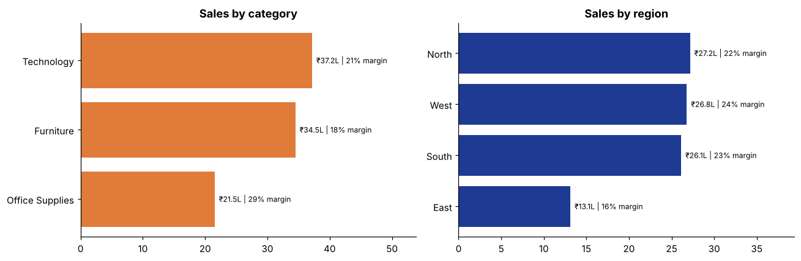
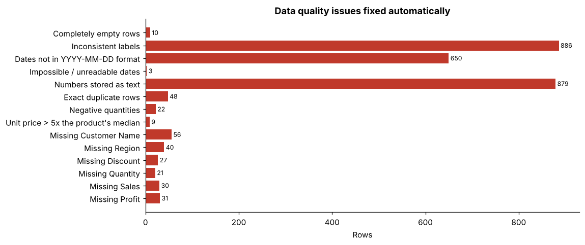

# Automated Sales Report

*Generated automatically by `clean_and_report.py` on 09 Nov 2026, 13:47*

**Files processed:** 10 (2026-01 to 2026-10) · **Raw rows:** 1,622 · **Clean rows:** 1,561

## Key metrics
| Total Sales | Total Profit | Margin | Orders | Customers | Avg Order Value |
|---|---|---|---|---|---|
| ₹9,319,664 | ₹2,024,245 | 21.7% | 1,561 | 400 | ₹5,970 |

## Highlights
- Best month: **2026-10** with ₹1,314,992 in sales.
- Latest month (2026-10) sales were **₹1,314,992**, up **31.5%** from 2026-09.
- Top region: **North** (29.2% of sales). Top category: **Technology** (39.9%).
- Best product: **Folding Table** (₹424,908).
- ⚠️ Loss-making sub-categories: **Tables** (₹-73,938).

## Monthly performance

| Month | Sales | Profit | Orders | Margin (%) | MoM Sales Change (%) |
|---|---|---|---|---|---|
| 2026-01 | ₹1,024,857 | ₹203,823 | 136 | 19.9% | – |
| 2026-02 | ₹774,002 | ₹172,750 | 126 | 22.3% | -24.5% |
| 2026-03 | ₹772,316 | ₹182,758 | 152 | 23.7% | -0.2% |
| 2026-04 | ₹893,758 | ₹202,526 | 143 | 22.7% | +15.7% |
| 2026-05 | ₹764,869 | ₹149,779 | 135 | 19.6% | -14.4% |
| 2026-06 | ₹944,190 | ₹210,345 | 151 | 22.3% | +23.4% |
| 2026-07 | ₹914,280 | ₹186,153 | 144 | 20.4% | -3.2% |
| 2026-08 | ₹916,591 | ₹201,385 | 158 | 22.0% | +0.3% |
| 2026-09 | ₹999,810 | ₹223,778 | 190 | 22.4% | +9.1% |
| 2026-10 | ₹1,314,992 | ₹290,948 | 226 | 22.1% | +31.5% |

## Category and region

| Category | Sales | Profit | Orders | Margin (%) | Share of Sales (%) |
|---|---|---|---|---|---|
| Technology | ₹3,717,175 | ₹784,932 | 322 | 21.1% | 39.9% |
| Furniture | ₹3,448,605 | ₹614,741 | 437 | 17.8% | 37.0% |
| Office Supplies | ₹2,153,884 | ₹624,572 | 802 | 29.0% | 23.1% |

| Region | Sales | Profit | Orders | Margin (%) | Share of Sales (%) |
|---|---|---|---|---|---|
| North | ₹2,717,494 | ₹588,948 | 458 | 21.7% | 29.2% |
| West | ₹2,678,947 | ₹639,045 | 455 | 23.9% | 28.7% |
| South | ₹2,612,241 | ₹592,328 | 423 | 22.7% | 28.0% |
| East | ₹1,310,982 | ₹203,925 | 225 | 15.6% | 14.1% |

## Top 10 products
| Product Name | Category | Sales | Units |
|---|---|---|---|
| Folding Table | Furniture | ₹424,908 | 121 |
| Smartphone | Technology | ₹366,568 | 21 |
| Laser Printer | Technology | ₹360,652 | 24 |
| Executive Leather Chair | Furniture | ₹355,818 | 27 |
| Mini PC | Technology | ₹343,889 | 15 |
| Laptop | Technology | ₹336,260 | 7 |
| Mesh Task Chair | Furniture | ₹315,147 | 69 |
| Multifunction Copier | Technology | ₹271,886 | 8 |
| Tablet | Technology | ₹271,022 | 13 |
| Ergonomic Office Chair | Furniture | ₹265,522 | 35 |

---

## Data quality report

| Step | Issue found | Rows affected | Action taken |
|---|---|---|---|
| Blank rows | Completely empty rows | 10 | Removed |
| Standardise text | Inconsistent labels (e.g. 'S', 'Tech', 'Corp.', 'MUMBAI') | 886 | Mapped to standard values |
| Parse dates | Dates not in YYYY-MM-DD format | 650 | Converted to a proper date |
| Parse dates | Impossible / unreadable dates (e.g. 31/02/2026) | 3 | Removed |
| Fix numbers | Numbers stored as text ('₹' symbols, commas, '%') | 879 | Converted to numeric |
| Duplicates | Exact duplicate rows | 48 | Removed (kept first) |
| Duplicates | Repeated Order IDs | 0 | Removed (kept first) |
| Invalid values | Negative quantities (sign typo) | 22 | Converted to positive |
| Invalid values | Unit price > 5x the product's median (extra zeros) | 9 | Replaced with product median price |
| Missing values | Missing Customer Name | 56 | Filled from the same Customer ID's other orders |
| Missing values | Missing Region | 40 | Filled from the State |
| Missing values | Missing Discount | 27 | Calculated as 1 − Sales ÷ (Quantity × Price) |
| Missing values | Missing Quantity | 21 | Calculated as Sales ÷ (Price × (1 − Discount)) |
| Missing values | Missing Sales | 30 | Calculated as Quantity × Price × (1 − Discount) |
| Missing values | Missing Profit | 31 | Estimated from the sub-category's median margin (flagged) |
| Missing values | Rows that could not be recovered | 0 | Removed |

### Before → after (sample rows)
**Raw**

| Order ID | Order Date | Region | Category | Segment | Discount | Sales |
|---|---|---|---|---|---|---|
| ORD-104391 | 2026-01-14 | north | Furniture | Consumer | 0% | ₹978.00 |
| ORD-104393 | 20/01/2026 | S | Furniture | Corporate | 10% | ₹4,287.60 |
| ORD-104418 | 2026-01-11 | WEST | OfficeSupplies | Consumer | 0% | ₹1,080.00 |
| ORD-104499 | 2026-01-25 | (missing) | OfficeSupplies | Consumer | 0% | ₹852.00 |

**Cleaned**

| Order ID | Order Date | Region | Category | Segment | Discount | Sales |
|---|---|---|---|---|---|---|
| ORD-104391 | 2026-01-14 | North | Furniture | Consumer | 0.0 | 978.0 |
| ORD-104393 | 2026-01-20 | South | Furniture | Corporate | 0.1 | 4287.6 |
| ORD-104418 | 2026-01-11 | West | Office Supplies | Consumer | 0.0 | 1080.0 |
| ORD-104499 | 2026-01-25 | East | Office Supplies | Consumer | 0.0 | 852.0 |

### Validation checks
| Check | Result |
|---|---|
| No missing values in key columns | PASS |
| Order IDs are unique | PASS |
| Only valid regions | PASS |
| Only valid categories | PASS |
| Only valid segments | PASS |
| Quantities are positive | PASS |
| Discounts between 0 and 1 | PASS |
| Sales = Qty × Price × (1 − Discount) (±2%) | PASS |
